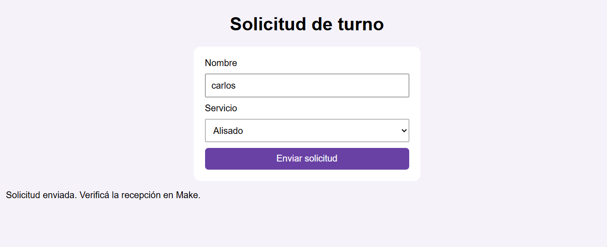
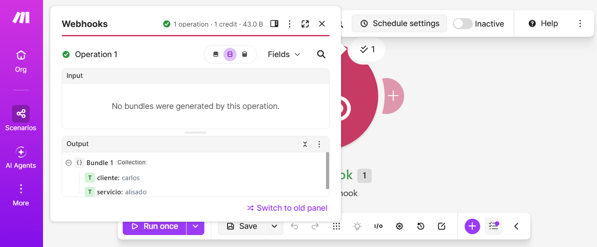
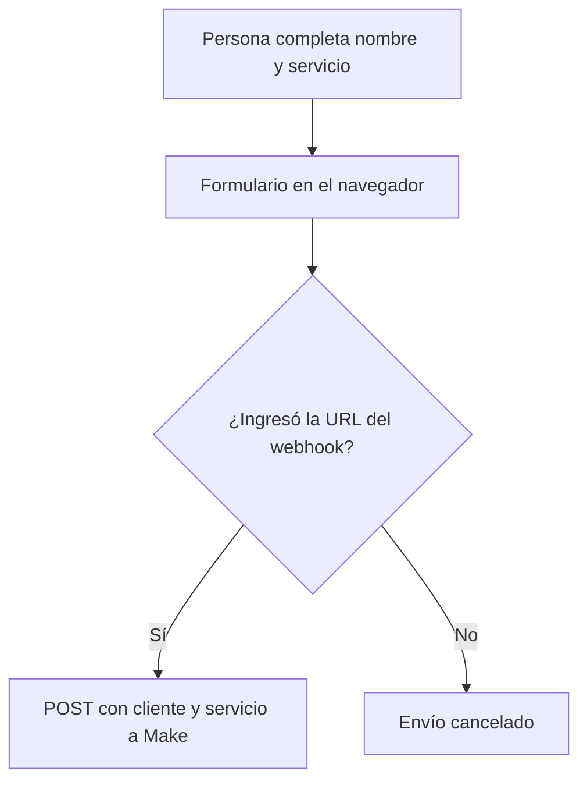

# Día 28: proyecto integrador del primer mes

## Objetivo

Crear un formulario web que envíe una solicitud de prueba
a un webhook de Make.

## Componentes

- HTML: define los campos de nombre y servicio.
- CSS: da formato visual al formulario.
- JavaScript: lee los campos y realiza el envío.
- Make: recibe los datos mediante un webhook.

## Funcionamiento

1. La persona completa el nombre y selecciona un servicio.
2. Al presionar Enviar solicitud, JavaScript evita que la página se recargue.
3. El formulario pide la URL del webhook mediante un cuadro de diálogo.
4. JavaScript envía cliente y servicio mediante una petición POST.
5. Make recibe ambos campos.

La URL del webhook se ingresa durante la prueba y no queda
escrita en el archivo HTML.

## Prueba realizada

Completé el formulario y envié una solicitud.
Abrí el resultado de la ejecución en Make y comprobé
que llegaron el nombre y el servicio.

## Alcance

Es una prueba de envío de datos. No crea ni confirma un turno.

El envío usa no-cors: JavaScript no puede leer la respuesta
del servidor. El mensaje del formulario no confirma la recepción;
la comprobación se realiza en Make.
## Capturas de la prueba

### Formulario después del envío

### Datos recibidos en Make

## Arquitectura

El navegador ejecuta el HTML, CSS y JavaScript de dia27.html.
JavaScript lee los campos y prepara los datos con URLSearchParams.
Make recibe la petición mediante su webhook.

Esta versión conecta el formulario directamente con Make.
La API Flask del día 21 es una práctica separada y no participa
en este recorrido.